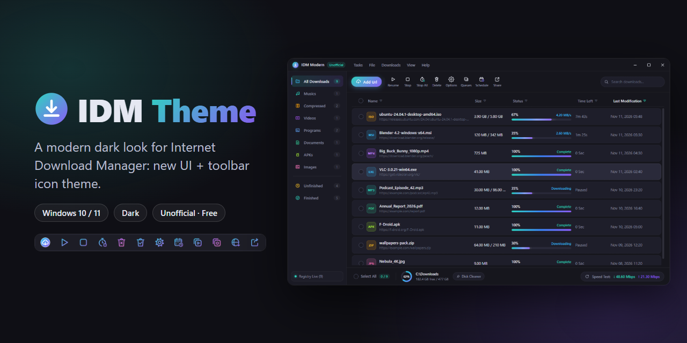
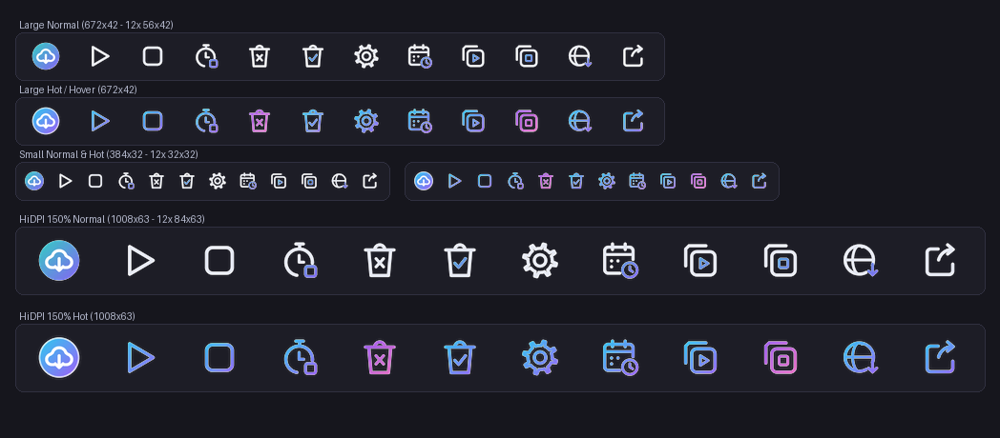

<div align="center">

# IDM Theme

[English](README.md) · **فارسی**

<a href="https://hits.sh/github.com/Plus98ir/IDM-Theme/"></a> <a href="https://corenetbase.com/#support"></a>

<div dir="rtl">

ظاهر مدرن و تیره برای Internet Download Manager: یک رابط کاربری جدید با دکمه‌های پنجره‌ی ویندوزی، به‌همراه تم آیکون تولبار برای خود IDM.

</div>



</div>

<details>
<summary><b>☕ Support · حمایت</b> — USDT (TRC20) / TRX</summary>
<br>
<p align="center"></p>

```
TA53aFyGNfSAcrCaJi9QmA9x5W47nPJcf7
```

> [!WARNING]
> **TRON network only.** Sending from ERC20 / BEP20 will lose the funds.<br>
> **فقط شبکه‌ی TRON.** ارسال از ERC20 یا BEP20 پول را از بین می‌برد.

</details>

<div dir="rtl">

> [!NOTE]
> این پروژه غیررسمی است و هیچ ارتباطی با شرکت Tonec (سازنده‌ی IDM) ندارد. «Internet Download Manager» و «IDM» علامت تجاری صاحبشان است.

## دانلود

- **برنامه‌ی IDM Modern:** [`IDM-Modern-win-x64.zip`](https://github.com/Plus98ir/IDM-Theme/releases/latest/download/IDM-Modern-win-x64.zip). فایل را باز کنید و `IDM Modern.exe` را اجرا کنید. نصب و Node.js لازم ندارد.
- **تم تولبار:** [`UIUXMonster-Dark-Toolbar.zip`](https://github.com/Plus98ir/IDM-Theme/releases/latest/download/UIUXMonster-Dark-Toolbar.zip)
- **وبسایت:** https://corenetbase.com/IDM-Theme/

خود IDM باید نصب باشد (تست‌شده با نسخه‌ی 6.43 روی ویندوز ۱۰ و ۱۱).

## ۱. IDM Modern

یک برنامه‌ی جدا که دانلودهای IDM را در یک پنجره‌ی مدرن و تیره نشان می‌دهد.

- لیست دانلودها را زنده از رجیستری (`HKCU\Software\DownloadManager`) می‌خواند و هر ۱۵ ثانیه تازه می‌کند.
- دسته‌بندی، جستجو، مرتب‌سازی، نوار پیشرفت، فضای دیسک و تست سرعت.
- باز کردن فایل یا پوشه، کپی لینک، دانلود دوباره و حذف از لیست.
- افزودن دانلود، صف‌ها و اتصال به مرورگر را به خود IDM می‌سپارد (`IDMan.exe /d <url>` و `/s`)، پس هیچ چیز IDM عوض نمی‌شود.
- دکمه‌های پنجره مثل ویندوز ۱۱ سمت راست هستند: کوچک‌کردن، بزرگ‌کردن/برگرداندن، و بستن با hover قرمز.

اگر بار اول Windows SmartScreen هشدار داد: **More info ← Run anyway** (فایل exe امضای دیجیتال ندارد).

### باز شدن IDM Modern هر بار که IDM را باز می‌کنید

در پوشه‌ی باز‌شده روی `set-default.ps1` راست‌کلیک ← **Run with PowerShell**. این اسکریپت:

- برنامه را در `%LOCALAPPDATA%\Programs\IDM Modern` نصب می‌کند،
- شورتکات‌های IDM روی دسکتاپ، Start Menu و تسک‌بار را به IDM Modern وصل می‌کند (آیکون IDM می‌ماند)،
- برای پنجره‌ی قدیمی، شورتکات **IDM Classic** را به Start Menu اضافه می‌کند.

- آیکون IDM Modern را کنار ساعت نشان می‌دهد و آیکون خود IDM را به منوی `^` می‌برد (ویندوز ۱۱).

IDM Modern خود IDM را در پس‌زمینه روشن می‌کند تا اتصال به مرورگر کار کند. مثل IDM، دکمه‌ی ✕ برنامه را به کنار ساعت می‌برد و **Tasks ← Exit** یا منوی آیکون کنار ساعت آن را می‌بندد. چیزی با روشن شدن ویندوز اجرا نمی‌شود، مگر تنظیم خود IDM.

برگرداندن: `.\set-default.ps1 -Undo`

## ۲. تم تولبار UIUXMonster Dark

۱۲ آیکون تازه برای تولبار خود IDM در سه اندازه (بزرگ `56×42`، کوچک `32×32`، HiDPI `84×63`)، هر کدام با حالت hover رنگی.

</div>



<div dir="rtl">

۱. zip را باز کنید و روی `install.ps1` راست‌کلیک ← **Run with PowerShell** (برای کپی در `Program Files` دسترسی ادمین می‌خواهد).
   یا ۷ فایل پوشه‌ی `UIUXMonster-Dark\` را دستی در `C:\Program Files (x86)\Internet Download Manager\Toolbar\` کپی کنید.<br>
۲. IDM را از منوی **Tasks ← Exit** کامل ببندید و دوباره باز کنید.<br>
۳. **View ← Toolbar ← UIUXMonster Dark** را انتخاب کنید و **View ← Dark Mode support** را روشن کنید (ویندوز هم روی حالت تیره باشد).

حذف: `.\install.ps1 -Uninstall`

IDM موتور اسکین کامل ندارد؛ داخل پنجره‌ی خود IDM فقط تولبار و Dark Mode داخلی‌اش قابل تغییر است. ظاهر جدید بالا مربوط به برنامه‌ی جدای IDM Modern است.

## ساخت از سورس

</div>

```powershell
cd idm-ui
npm install
npm start                 # یا دابل‌کلیک روی Launch-IDM-Modern.cmd
```

<div dir="rtl">

- `.\build.ps1` هر دو zip انتشار را در پوشه‌ی `release\` می‌سازد.
- `python generate_theme.py` آیکون‌های تولبار را دوباره می‌کشد (Pillow لازم دارد).

## مجوز

MIT

</div>
